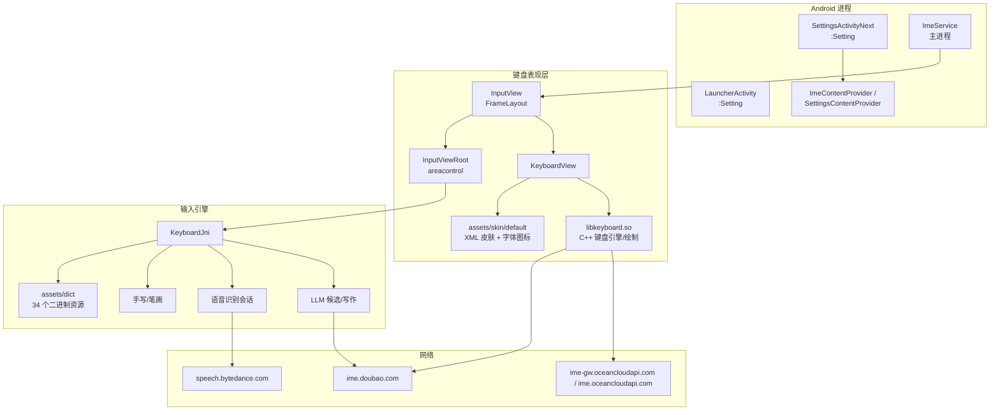

# 豆包输入法 1.5.2 — REA 静态与运行时分析事实集

> 目标：`com.bytedance.android.doubaoime`，官方 Android arm64 APK，`versionName=1.5.2`，`versionCode=100502008`。  
> 方法：REA 6.7.0（`inspect-android-package`，JADX headless 0.7.1）+ apktool 2.11.1 + JADX 1.5.1 + Pixel 10 Pro XL API 36 运行时取证。  
> 证据等级：`[O]` 直接观察（清单/资源/代码/截图）；`[I]` 由结构或行为推断；`[U]` 未能验证。  
> 本文件是报告与三个复刻实现的事实源；不包含任何密钥、完整账号、私有词典内容或可复制源码。

---

## 1. 制品身份

| 项 | 值 |
|---|---|
| 官方下载 API | `https://shurufa.doubao.com/api/v1/app/download_url?platform=android` |
| 官方 APK | `doubaoime_v1.5.2_100502008_official_arm64_release.apk` |
| 大小 | 177,752,??? B（169 MiB 下载，磁盘 `170M`） |
| SHA-256 | `dd96dd84fd8e09fc98b46e71ee8df9d1a44ec8b1bfaa3e1ce1e49ddb6e56c08f` |
| 包名 | `com.bytedance.android.doubaoime` |
| versionName / Code | `1.5.2` / `100502008` |
| minSdk → targetSdk | `26 → 37`（compileSdk 35） |
| ABI | 仅 `arm64-v8a`（官方渠道包） |
| 签名 DN | `OU=北京春田知韵科技有限公司, O=北京春田知韵科技有限公司, L=北京市西城区阜成门外大街31号4层408D, ST=北京, C=CN` |
| 证书 SHA-256 | `d47cafb450b9c8191180402795f35ce50ce2d8b37f1300b42e7d8633bc86b7df` |
| releaseTime | `20261019.1338` |
| DEX | 4 个，`classes.dex` 9.9 MB + `classes2.dex` 10.4 MB + `classes3.dex` 9.1 MB + `classes4.dex` 1.9 MB |
| 类总数 | 23,039（REA/JADX 元数据） |
| 资源条目 | 3,367 |
| 组件 | 70 Activity + 1 activity-alias + 72 Service + 12 Receiver + 23 Provider |
| 权限 | 41 |
| 入口 | `LauncherActivity`（`:Setting` 进程）→ `SettingsActivityNext` 或 `ImeGuideActivity` |
| IME Service | `com.bytedance.android.doubaoime.ImeService`，label `@string/keyboard_name`，`BIND_INPUT_METHOD` |
| 辅助服务 | `ImeAccessibilityService`（助写/无障碍）、`ImeEngineHostNetworkService`（`:Setting`）、`TaskService`、升级/推送/WebView 沙箱等 |

### 官方站点/多端

- PC 下载页：`https://shurufa.doubao.com/pc`
- 官方下载 API 同时返回 macOS / Windows / HarmonyOS 安装包。
- iOS App Store：`com.bytedance.ios.doubaoime`，`1.6.2`，最低 iOS 15.0，iPhone-only（`ipadScreenshotUrls` 为空），体积 357,684,224 B。
- iOS 应用名：`豆包输入法 - 豆包同款语音输入`，开发者 `Beijing Chuntian Zhiyun Technology Co., Ltd.`。

---

## 2. 总体架构

### 关键事实

- `ImeService` 继承 `LifecycleInputMethodService`，持有静态 `InputView F`、`InputConnectionWrapper`、`SelectionTracker`、`AdbReceiver` 等；`onCreateInputView` 创建/复用 `InputView`。
- `InputView` 是 `FrameLayout`，内部持有两个 `KeyboardView`（`f7519a` / `b`）、三个 `InputViewRoot`、`AiPanelView`、`AsrEditorLayoutView`、Lottie 动画等。
- 键盘主布局来自 **APK 资产内的 XML 皮肤**：`assets/skin/default/input_main.xml`、`layout/input_kbd_pinyin26.xml`、`input_kbd_pinyin9.xml`、`input_kbd_wubi.xml`、`input_kbd_stroke.xml`、`input_toolbar_idle.xml` 等；不是 Android 原生布局。
- `libkeyboard.so`（4.9 MB）包含键盘布局解析、绘制、候选/触摸逻辑；`libime_net_sdk.so`（6.6 MB）包含网络/云输入；`liboime-config.so`（545 KB）配置；`libskity.so`/`librelax.so`/`libquick.so` 为渲染/动画/性能组件。
- `KeyboardJni` 暴露 50+ 功能键常量：语音、剪切板、表情、常用语、键盘选择、繁简、单手、手写找字、撤销删除、AI 写作、AI 聊天、百科、翻译、定制工具栏、侧边符号等。
- 离线资源：`assets/dict` 34 个二进制文件，总计 164 MB；`assets/skin` 1.3 MB；`assets/lottie` 3.7 MB；`assets/symbol` 64 KB。`assets/dict/asr` 为离线语音模型（约 7 MB），设置页提示完整离线语音包 `177M`。
- 运行时 `ImeService` 的 `mSettingsActivityName=...LauncherActivity`，`ime list` 可见；默认输入法由系统设置控制。
- 包内同时集成：Lynx/Bullet 动态页、ByteNN、Turing 风控/活体、火山/字节推送、Chromium WebView、ML Kit 条码、账号 SDK（Larus）、跨端复制、APM/埋点、应用升级。复刻不应复制这些基础设施。

---

## 3. 功能清单（观察 + 推断）

### 3.1 输入方式

| 键盘 | 证据 | 行为 |
|---|---|---|
| 拼音 26 键 | 皮肤 `input_kbd_pinyin26.xml`；设置页“拼音26键” | QWERTY，字母上滑数字/符号，长按候选，分词键，中英切换，空格语音 |
| 拼音 9 键 | `input_kbd_pinyin9.xml`；设置页“拼音9键” | T9 布局，侧边符号列，重输键，候选翻页 |
| 手写 | `input_kbd_stroke.xml`/手写板布局；设置页“手写键盘” | 全屏手写画布，右侧符号列，候选/删除；支持手写找字 |
| 笔画 | 设置页“笔画键盘” | 五笔画输入（横竖撇捺折 + 通配） |
| 双拼 | 设置页“双拼键盘” | 26 键双拼；小鹤双拼、自然码双拼；9 键双拼“敬请期待” |
| 五笔 | 设置页“五笔键盘” | 86 版五笔；编码提示、拼音混输、四码唯一上屏、第五码首选上屏 |
| 英文 26 键 | 皮肤 `input_kbd_english26.xml` | 中英切换、首字母大写、双击空格句号 |
| 数字/符号 | 皮肤 `input_kbd_number*.xml`、`input_kbd_symbol.xml` | 数字、符号、更多符号、侧边栏自定义符号 |
| 单手 | `ime_onehand_left.xml` / `ime_onehand_right.xml` | 左右单手模式、键盘高度/位置调整 |
| 悬浮 | `floating` 皮肤、`floating_keyboard_*` 字符串 | 悬浮键盘、拖动、恢复原尺寸 |

### 3.2 语音

- 入口：空格键语音图标、候选栏语音键、“点击说话”工具条、工具箱“语音输入”、长按空格。
- 状态：`正在倾听 点击结束` → `识别优化中` → 结果编辑；错误：`没听清，请重新开始`、`话筒被占用`、`服务端异常`、`请连接网络后再试`。
- 能力：中英混输、多方言、离线语音、标点策略、口水词去除（正常/激进）、智能文字整理、语音口令发送（“帮我发送/我说完了/立即发送/发送发送/overover”）、长按编辑/撤回/发送。
- 离线：`assets/dict/asr`，设置页可下载 `177M` 离线包；弱网/无网自动切换（可配置）。
- 相关代码：`com.bytedance.android.input.speech.*`、`AsrManager`、`AsrEditorLayoutView`、`AsrTextView`、`ImeProcessAsrInputDispatcher`；接口 `IRecommends.AsrRecordApi` (`POST /api/v1/asr/record`)、`AsrFmtApi` (`POST /api/v1/asr/fmt`)。

### 3.3 AI 能力

| 能力 | UI 入口 | 接口/实现 |
|---|---|---|
| 智能联想 | 候选栏；设置“智能联想”“输入预测类型” | 本地联想 + 云候选；`cloud_candidate_refresh_timeout`、`association_delay_refresh` |
| AI 写作 | 工具箱/AI 面板 | `POST /api/v1/bot/rich_chat`（通用）、`POST /api/v1/bot/chat`（场景）；流式 `BufferedReader` |
| 智能文字整理 | 语音结果/工具箱 | `POST /api/v2/ai/text_organization`，SSE 流；请求 `scene/query/space_at_cn_en_nb/space_at_newline/stream`；响应 `content/no_rewrite/code/msg/message` |
| 文本纠错 | 候选/AI 检查 | `POST /api/v1/rectify_text`，请求 `text/rectify_type/grammar` |
| 翻译 | 工具栏翻译 | `POST /api/v1/translate`；`libkeyboard.so` 也直接请求 |
| 话题/聊天意图 | AI 聊天助手 | `POST /api/v1/topic_make`（`history`） |
| 快捷回复 | AI 聊天助手 | `GET /api/v1/quick_reply?context=...` |
| 表情推荐 | 候选/表情面板 | `GET /api/v2/emoticons/hot_list`、`/query`、`POST /query_hit`、`/commit_record` |
| 百科/富聊天 | AI 聊天助手 | `POST /api/v1/bot/chat`、`rich_chat`；`Data.Source` 含 CHAT/POPULAR/CIRCLE/MAIL/EVALUATE/BLESSING/INVITATION/INTRODUCTION/OPTIMIZE/REWRITE/SUMMARY/KEYPOINTS/LIST/INTENTRECOGNIZE/BAIKE/POLISH/EXPANSION |
| 文本改写/总结/要点/列表 | AI 写作详情页 | 同一流式接口，`scene` + `output_format` |

- AI 写作请求模型（`IAiWriting.a`）：`scene:int`、`query:String`、`preceding_part:String`、`follows_below:String`、`format_query:String`、`output_format:int=3`。
- AI 写作面板类：`AiPanelView`、`MenuView`、`DetailView`、`CheckView`，入口图标 `btn_ai_entrance`，功能键 `KEY_AIWRITING_CHECK/REWRITE/SUMMARY`、`KEY_AI_CHAT_ASSISTANT`、`KEY_BAIKE_TOPIC_ASSISTANT`。
- 设置：`AI能力设置`、`智能输入模式`、`云端使用部分输入信息`、`云端使用个人词库`、`AI聊天助手`（微信/QQ/飞书/抖音/小红书等场景）、`应用管理`。
- 合规文案明确：输入信息/应用场景加密上传，原文不存储；AI 聊天助手需检测聊天上下文。

### 3.4 剪贴板与超级互传

- 本地剪贴板：候选栏展示、历史记录、拆词、常用语、清空、首次开启同意。
- 跨设备（超级互传）：登录同一账号，手机/电脑互传文字与图片；“无损超长文本/多格式图片”“低延迟”；设备管理、添加设备、本机标识、启用开关。
- 接口：`/api/v2/auth/sync`、`/api/v2/clipboard/config`、`/api/v2/clipboard/pull`、`/api/v2/clipboard/switch`、`/api/v2/stream/clipboard/text/copy`、`/api/v2/stream/clipboard/rich/copy`、`/api/v2/clipboard/image/token`。
- 本地优先/云端同步：账户页有“数据同步 / 个人词库 / 常用语”开关，默认开启。

### 3.5 账号与同步

- 账号页“我的”：未登录、豆包账号登录、消息中心、数据同步、个人词库、常用语、超级互传。
- 登录：`ImeAccountBulletContainerActivity`（Lynx/Bullet WebView），`豆包账号登录`；扫码登录（`ScanLoginActivity`，扫 Mac 端二维码）；账号 SDK 支持一键登录/风控/短信。
- 接口：`/api/v3/context/ime/login`、`/logout`、`/api/v2/auth/sync`、`/api/v2/sync/settings`、`/api/v3/context/ime/user_words`、`/modify_pair`、`/ner`、`/api/v1/user/get_config`、`/api/v1/user/check_auth`、`/api/v2/im/message/*`。
- 消息中心：`/api/v2/im/message/list`、`/delete`、`/read_reported`。

### 3.6 设置项（运行时页面）

运行时已逐页取证，截图位于 `evidence/runtime/screenshots/`。

| 页面 | 关键内容 | 截图 |
|---|---|---|
| 首次引导 | 第一步启用、第二步切换 | `01_launcher.png`、`57_guide_enable.png`、`58_guide_step2.png` |
| 隐私声明 | 智能输入模式 vs 基础输入模式、用户协议/隐私政策 | `02_ime_system_settings.png`、`21_privacy.png` |
| 主设置 | 头像/账号、6 张轮播 banner、语音输入、键盘输入、超级互传、剪切板、验证码、通讯录、词库、隐私与权限、更多 | `07_settings_main.png`、`107_main_top2.png` |
| 语音转文字 | 智能文字整理、分段方式、标点展示、口水词、语音入口、离线语音、其他 | `10_voice_settings.png`、`11_voice_settings_bottom.png` |
| 键盘类型 | 拼音9/26、手写、笔画、双拼、五笔 | `12_keyboard_types.png`、`49_types_again.png` |
| 双拼 | 小鹤/自然码、9键双拼敬请期待 | `13_shuangpin.png` |
| 五笔 | 86版、编码提示、拼音混输、四码唯一、第五码首选 | `14_wubi.png` |
| 布局与显示 | 候选字大小、拼音显示位置、26键数字符号合并/分开、逗句号、中英切换位置、外观、上滑数字符号、侧边栏符号、回车发送 | `15_layout_top.png`、`16_layout_mid.png`、`17_layout_bottom.png` |
| 模糊拼音 | 声母 z=zh/c=ch/s=sh/h=f/n=l/r=l；韵母 an=ang/en=eng/in=ing/ian=iang/uan=uang/un=ong/eng=ong；音节 hui=fei/huang=wang | `75_fuzzy_on.png`、`76_fuzzy_on_bottom.png` |
| 智能联想 | 开关 | `77_association.png` |
| 输入预测类型 | Emoji、图片表情、颜文字 | `80_input_recommend.png` |
| 按键反馈 | 响应速度、声音、振动强度、26键气泡 | `85_key_feedback.png`、`86_key_feedback_bottom.png` |
| 快捷格式输入 | 中英数空格、首字母大写、双击空格句号 | `87_quick_format.png` |
| 超级互传 | 特性、登录并启用 | `92_super_transfer.png` |
| 剪切板 | 候选栏展示、历史记录 | `93_clipboard_settings.png` |
| 词库管理 | 个人词库/通讯录词库清空 | `96_lexicon.png` |
| 输入模式与信息保护 | 智能/基础模式、第三方共享、协议、权限清单、更多设置 | `97_input_mode.png` |
| 智能输入设置 | 云端使用输入信息、个人词库 | `99_smart_input.png` |
| 系统权限设置 | 短信、通讯录、麦克风、相机、通知 | `102_system_permissions.png` |
| 账户 | 未登录、消息中心、数据同步、词库/常用语、超级互传 | `108_account.png` |
| 登录 | 豆包账号登录、加载中 | `109_login.png`、`110_login_page.png` |
| 帮助与反馈 | Web 客服中心（依赖后端） | `103_help.png`、`104_help_loaded.png` |
| 关于 | 1.5.2 / build 20261019.1338 / DID | `105_about.png` |
| 电脑版 | macOS/Windows、官网、复制网址 | `106_desktop.png` |
| 键盘 26 键 | 工具条、候选、QWERTY、语音空格、搜索/发送 | `26_keyboard_26_active.png`、`27_keyboard_typing.png`、`33_keyboard_clean.png` |
| 键盘 9 键 | T9、侧边符号、重输 | `45_keyboard_9key.png` |
| 手写 | 手写画布、侧边符号 | `46_handwriting.png`、`48_handwriting_active.png`、`51_handwriting_keyboard.png` |
| 键盘选择面板 | 6 种键盘卡片 | `44_keyboard_switcher.png` |
| 工具箱 | 语音、表情、键盘选择、智能整理、常用语、剪切板、定制工具栏、手写找字 | `34_toolbox_open.png` |
| 表情 | Emoji / 表情图 / 颜文字 | `38_emoji_panel.png`、`39_emoji_stickers.png`、`40_kaomoji.png` |
| 剪切板首次开启 | 授权说明、开启/取消 | `65_clipboard.png` |
| 语音浮层 | 倾听、失败“请连接网络后再试” | `53_voice_overlay.png`、`54_voice_overlay_after.png` |

### 3.7 设置页 Fragment 枚举（代码级）

`SettingsActivityNext.FragmentType`：`MAIN, FUZZY, VOICE_INPUT, KEY_FEEDBACK, KEY_AUXILIARY_INPUT, INPUT_MODE, AI_CHAT_ASSISTANT, DEBUG_SETTINGS, ABOUT, KBD_LAYOUT, CLIPBOARD, LEXICON_MANAGEMENT, SYSTEM_PERMISSION, DESKTOP, OFFLINE_DOWNLOAD, INTELLIGENT_ASSOCIATION, INPUT_RECOMMEND, SMART_INPUT, MESSAGE_CENTER, CUSTOM_SYMBOL, MULTIPLE_INPUT_TYPE, DOUBLE_SPELL_PAGE, VOICE_INPUT_ACTION, VIDEO_PLAY, SUPER_TRANSFER, ACCOUNT, HELP_AND_FEEDBACK, WUBI_PAGE`。

深链入口（可用于复刻路由/测试）：
- `SettingsActivityNext` 额外参数 `EXTRA_FRAGMENT_TYPE=<枚举名>`；其他：`EXTRA_GUIDE_SCENE`、`EXTRA_KEYBOARD_SWITCH_ENTRY_SOURCE`、`EXTRA_KEY_CUSTOM_SYMBOL`、`EXTRA_MESSAGE_ID`、`EXTRA_OFFLINE_MODEL_DOWNLOAD_WAY`、`EXTRA_SETTINGS_SOURCE`、`EXTRA_WEB_URL`。
- `snssdk401734://`、`oime://` 深链；App Link host `doubaoime.zlinkurl.cn` / `zlinkurl.cn`。

---

## 4. 后端服务与接口

### 4.1 域名

| 域名 | 观察 |
|---|---|
| `https://ime.doubao.com` | 主网关；`/api/v1/ip/info` 未登录可 200；API/账号/同步/AI/ASR/剪贴板/表情均在此域 |
| `https://ime-gw.oceancloudapi.com` | 海外/备用网关；TLS 连接在本机不稳定 |
| `https://ime.oceancloudapi.com` | 海外/备用；根路径 404 |
| `https://speech.bytedance.com` | 语音服务；根路径 404 |
| `https://is.snssdk.com` | 设备注册/风控 |
| `https://lf-wave.doubaocdn.com` | 官方安装包/引导视频 CDN |
| `https://lf3-cdn-tos.draftstatic.com` | 隐私政策/用户协议 CDN |

### 4.2 接口清单

| Method | Path | 用途 | 证据 |
|---|---|---|---|
| GET | `/api/v1/ip/info` | IP/地区 | 运行 curl 200 |
| POST | `/api/v1/asr/record` | 语音识别 | `IRecommends.AsrRecordApi` |
| POST | `/api/v1/asr/fmt` | 语音结果格式化 | `IRecommends.AsrFmtApi` |
| GET | `/api/v1/ai/process` | AI 处理（`str_vars`、`streaming`、`chain_task`） | `IRecommends.Api` |
| POST | `/api/v1/bot/chat` | 场景化 AI 流式聊天 | `IAiWriting.StreamingApiScene` |
| POST | `/api/v1/bot/rich_chat` | 通用 AI 写作流式 | `IAiWriting.StreamingApiCommon` |
| POST | `/api/v2/ai/text_organization` | 智能文字整理 SSE | `SmartOrganizeApi` |
| POST | `/api/v1/rectify_text` | 文本纠错 | `ICorrectWord` |
| POST | `/api/v1/translate` | 翻译 | 字符串/原生 |
| POST | `/api/v1/topic_make` | 话题生成 | `IChatIntent.TopicApi` |
| GET | `/api/v1/quick_reply` | 快捷回复 | `IQuickReply` |
| POST | `/api/v1/ailab/transform` | AI 实验室转换 | 字符串 |
| POST | `/api/v1/keyboard/record` | 键盘行为上报 | 字符串 |
| POST | `/api/v1/event/report` | 事件上报 | 字符串 |
| POST | `/api/v1/bug_report` / `/bug/file_push` | 反馈 | 反馈 SDK |
| POST | `/api/v2/auth/sync` | 跨端认证同步 | `CrossDeviceClipboardApi` |
| POST | `/api/v2/sync/settings` | 设置同步 | `AccountSyncApi` |
| POST | `/api/v2/clipboard/config` | 剪贴板配置 | 同上 |
| POST | `/api/v2/clipboard/pull` | 拉取跨端内容 | 同上 |
| POST | `/api/v2/clipboard/switch` | 开关 | 同上 |
| POST | `/api/v2/stream/clipboard/text/copy` | 文本上传 | 同上 |
| POST | `/api/v2/stream/clipboard/rich/copy` | 富文本/图片上传 | 同上 |
| POST | `/api/v2/clipboard/image/token` | 图片上传 token | 同上 |
| GET | `/api/v2/emoticons/hot_list` | 热门表情 | `ImeEmoticons` |
| GET | `/api/v2/emoticons/query` | 上下文表情 | 同上 |
| POST | `/api/v2/emoticons/query_hit` | 表情命中上报 | 同上 |
| POST | `/api/v2/emoticons/commit_record` | 表情使用上报 | 同上 |
| GET | `/api/v2/version/list` | 词库/资源版本 | 同上 |
| POST | `/api/v2/im/message/list` | 消息中心列表 | `ImeMessageCenterApi` |
| POST | `/api/v2/im/message/delete` | 删除消息 | 同上 |
| POST | `/api/v2/im/message/read_reported` | 已读上报 | 同上 |
| POST | `/api/v3/context/ime/login` / `logout` | 账号上下文登录/登出 | `ImeLoginApi` / `ImeLogoutApi` |
| POST | `/api/v3/context/ime/ner` | 上下文实体识别 | `ImeNerApi` |
| POST | `/api/v3/context/ime/modify_pair` / `v2` | 语音修改对 | `ModifyPairApi` |
| POST | `/api/v3/context/ime/user_words` | 用户词 | `UserWordsApi` |
| POST | `/api/v1/user/get_config` | 用户配置/Token | `ImeTokenApi` |
| POST | `/api/v1/user/check_auth` | 鉴权检查 | `CheckAuthApi` |
| POST | `/api/v1/ai/process` | 通用 AI | 同上 |

### 4.3 原生直连

`libkeyboard.so` 内可见：

- `https://ime.doubao.com/obric/ime/cloud/convert`（云转换/候选）
- `/obric/ime/cloud/asso`、`/wordasso`（联想）
- `/gethotword?version=0`、`/getdelword?version=0`（热词/删除词）
- `/prefetch_ctx_regulator`（上下文调节预取）
- `https://ime.doubao.com/api/v1/translate`
- `https://ime.doubao.com/api/v1/sdk/dns_analysis?domain=`

### 4.4 后端不可获得性（关键结论）

1. **服务可达，但接口受鉴权/设备绑定/签名约束**。主域 `ime.doubao.com` 可访问，`/api/v1/ip/info` 未登录返回 200；业务接口需要 App 内生成的设备 ID、安装 ID、签名/风控 token、账号 token、TTNet 加密与灰度参数，不能仅凭 URL 复现。
2. **ASR 不是公开 API**。语音走 `speech.bytedance.com` + App 内会话/鉴权；离线模型在 APK 资产中，但格式/协议未文档化。运行时模拟器语音入口直接显示 `请连接网络后再试`，说明会话建立失败。
3. **AI 能力绑定豆包账号与风控**。`/api/v1/bot/*`、`/api/v2/ai/text_organization` 需要登录态与请求签名；未登录/模拟器调用会失败或返回风控页。
4. **表情图/客服/登录页是远程资源**。`表情图` Tab 在无后端时显示空白占位；帮助与反馈加载远程客服中心；登录页停在“加载中…”。
5. **跨端互传需要同一账号的设备注册**，服务端保存设备关系与消息；没有官方账号无法完成配对。
6. **iOS 版本无法在未授权条件下取得 IPA**。App Store 下载受 Apple ID/DRM 约束；本机未安装该 App，也没有可用 IPA。iOS 端逆向只能做公开元数据/界面行为分析，不能做二进制静态分析（详见第 7 节）。

**复刻策略**：不复刻官方私有协议；定义一套等价的、可替换的后端契约（见 `CLONE_SPEC.md`），默认本地/离线可用，AI 走用户自己的 OpenAI 兼容服务（DeepSeek）。

---

## 5. 运行时观察与限制

- 设备：Pixel 10 Pro XL API 36（arm64），1344×2992，density 480；专用 AVD `Doubao_IME_API_36`。
- 首次启动：`ImeGuideActivity` 两步引导；隐私声明有“智能输入模式/基础输入模式”二分；同意后进入设置或首次键盘类型选择。
- 首次键盘：全屏“选择键盘类型”引导（9键/26键/手写/笔画/双拼/五笔），选 26 键后出现工具条与键盘。
- 键盘工具条默认：左侧 logo/工具箱、语音“点击说话”、剪切板、翻译、表情、常用语、键盘选择、繁简、单手、手写找字、撤销删除、AI 入口、收起。
- 26 键实测：工具条、候选栏、QWERTY、上滑数字/符号、空格语音、中英切换、蓝色“搜索/发送”动作键、底部收起/地球。
- 9 键实测：T9、侧边符号列（，。？！）、重输键、空格语音。
- 手写实测：全屏画布、右侧符号列；未注入真实笔迹（模拟器触摸未绘出），但布局完整。
- 工具箱实测：8 个入口 + 分页指示；表情三 Tab；表情图无后端时空白。
- 语音实测：浮层出现“正在倾听”，随后错误“请连接网络后再试”；与后端鉴权/模拟器环境一致。
- 剪贴板首次开启：弹出授权说明；模拟器上按钮注入触摸未生效（IME 窗口触摸注入限制），但 UI 完整。
- 登录：点“豆包账号登录”进入 Bullet WebView，停在“加载中…”。
- 帮助与反馈：远程客服中心可加载出“客服中心 / Hi，亲爱的用户”，但依赖网络。
- 关于：版本 `1.5.2`，build `20261019.1338`，DID 可见。
- 设置页可正常点击/返回；主设置深链需在 Activity 新建时传入 `EXTRA_FRAGMENT_TYPE`，热实例不会重新路由（复刻时不要模仿这个限制）。

### 5.1 平板（Android pad）实测

- AVD：`Doubao_IME_Tablet_API_36`（medium_tablet，2560×1600，density 320，Android 16）。
- 官方设置页在平板上仍是**居中单列**，左右大量留白；无 NavigationRail/双栏。
- 键盘默认是**右侧悬浮紧凑键盘**（约 350×330 dp），带缩放/收起按钮、底部拖动条；不是全宽键盘。
- 首次键盘类型选择、工具箱、键盘切换都以右侧浮窗卡片出现；工具箱仅 8 项，`定制工具栏` 置灰。
- 26 键/9 键在浮窗内自适应；9 键压缩为 3 列数字键盘 + 左侧符号列。
- 截图：`tablet_03_settings.png`、`tablet_05_keyboard.png`、`tablet_06_keyboard26.png`、`tablet_07_toolbox.png`、`tablet_08_switcher.png`、`tablet_09_9key.png`。
- 结论：官方 pad 版是“手机信息架构 + 悬浮键盘”，不是真正的大屏重排；复刻可保留悬浮行为并增强双栏布局。

---

## 6. UI 设计令牌（从资源提取）

| 令牌 | 值 |
|---|---|
| 主色 | `#4F84FF` |
| 主色高亮 | `#3051F2` |
| 候选高亮文字 | `#4F84FF` |
| 候选普通文字 | `#D9000000` |
| 键盘背景 | `#EBEBEB`（`default_bk`） |
| 普通键背景 | `#FFFFFF` |
| 功能键背景 | `#BDC2C8` |
| 主文字 | `#000000` |
| 次级文字 | `#73000000` / `#80000000` |
| 分割线 | `#1A394C5A` / `#1F394C5A` |
| 设置页背景 | `#EDF6FF`（浅蓝） |
| 深色/浅色 | 跟随系统；`skin_colorscheme` 三态 |
| 圆角 | 键盘键约 8–10 dp；卡片 16–20 dp |
| 键盘字体 | 小米 MiSans Medium（`misans_medium`）+ 自有图标字体 `oimeui2023` |
| 26 键字母 | 约 57 px 设计值 → 约 19 dp（以 3x 资源换算） |
| 键盘高度 | 由 `input_view_*_height` 动态保存；单手/悬浮/调节可改 |

> 复刻使用系统字体/开源 MiSans 替代，图标用 Material Symbols 或自绘，不复制官方图标字体与皮肤 XML。

---

## 7. iOS 版本可行性

| 项 | 结论 |
|---|---|
| App Store 元数据 | 可获取：`com.bytedance.ios.doubaoime` 1.6.2，iOS 15+，iPhone-only，357 MB |
| IPA 获取 | **未取得**。App Store 下载需要已购买该 App 的 Apple ID；本机未登录/未安装；无已解密 IPA |
| 二进制静态分析 | **不可做**（无 IPA）。不能像 Android 一样给出 Mach-O/扩展 Info.plist/类清单 |
| 可做的分析 | App Store 描述、版本记录、截图、iOS 键盘扩展的公开架构（`UIInputViewController`、`RequestsOpenAccess`、App Group、内存限制） |
| 复刻 | iOS 原生版按 Android 行为 + iOS 键盘扩展规范实现；主 App 用 SwiftUI，键盘扩展用 UIKit；不声称二进制级一致 |
| 若要继续 | 需用户提供**有权访问的 Apple ID 下载的 IPA**，或提供已解密 IPA；之后可补 Mach-O/扩展分析 |

### 7.2 取证命令与结果

- `xcrun devicectl device info apps --device 00008130-001A6C411AFA001C`：已安装 App 列表中**没有** `com.bytedance.ios.doubaoime`（只有 ESP32 Agent、THU-150468、滴答清单测试 runner）。
- `itunes.apple.com/lookup?bundleId=com.bytedance.ios.doubaoime&country=cn`：返回 1.6.2、357,684,224 B、iPhone-only。
- 本机 `find /Users/lwblx -name '*.ipa'`：只有本项目/其他项目的自建 IPA，没有豆包输入法 IPA。
- 未安装 `ipatool`/Apple Configurator；无已登录的 App Store 下载账号上下文。
- 结论：在**不询问用户 Apple ID 凭据、不使用第三方解密 IPA**的前提下，无法取得 iOS 二进制；报告不伪造 iOS 静态分析结果。

### 7.1 App Store 公开物料（非二进制）

- 6 张官方截图显示 iOS 与 Android 共用视觉语言：浅蓝/白背景、圆角白键、蓝色动作键、`点击说话`、26 键布局。
- iOS 动作键为 `发送`/`搜索`；空格内语音波形；底部 `123`、逗号、`中/英`。
- iOS 独有：`语音免跳转`（默认/待机模式）、`来自其他手机复制的图片`、智能整理结果卡片。
- 仅证明公开 UI/文案，不能替代 IPA 静态分析；扩展类/网络栈/离线模型仍为 `[U]`。

iOS 键盘扩展的关键约束（公开知识，用于实现）：
- 键盘扩展是独立进程，内存上限远低于主 App（通常几十 MB），不适合嵌入 Flutter 引擎。
- 需要 `RequestsOpenAccess` 才能联网/共用容器；App Group 共享词库/设置。
- 主 App 与扩展通过 App Group + `UserDefaults`/共享文件通信。
- 扩展不能直接访问麦克风以外的敏感 API；语音需主 App 或扩展内受权限约束的录音。
- 系统键盘高度由扩展控制，需适配 iPhone/iPad 分屏/悬浮。

---

## 8. 复刻边界与合规

- 本项目是**净室行为复刻**：不复制官方 APK、DEX、SO、皮肤 XML、字体、词典二进制、图片/音频/Lottie 资源，也不把官方接口逆向为可滥用的私有协议。
- 复刻使用自有 UI 代码、开源字体/图标、公开词典数据（jieba/pypinyin，MIT）与用户自有的 DeepSeek API。
- 报告中的截图仅用于互操作性与功能分析；公开仓库不包含官方安装包与提取资源。
- 官方后端不可获得，复刻默认本地离线；AI/语音通过可替换后端适配层接入。

---

## 9. 证据文件索引

| 路径 | 内容 |
|---|---|
| `evidence/android/doubaoime_v1.5.2_...apk` | 官方 APK（不提交 Git） |
| `evidence/android/decoded/` | apktool 解码（不提交 Git） |
| `evidence/android/jadx_out/` | JADX 源码（不提交 Git） |
| `evidence/android/rea_inspect.json` | REA 包检查证据 |
| `evidence/android/manifest_components.json` | 组件清单 |
| `evidence/runtime/screenshots/` | 运行时截图 |
| `evidence/runtime/*.xml` | UI Automator 层级 |
| `analysis/FINDINGS.md` | 本文件 |
| `analysis/CLONE_SPEC.md` | 复刻规格与验收 |
| `reports/REPORT.md` / `reports/report.html` | 正式报告 |
